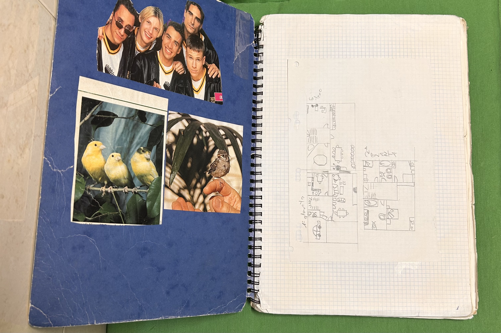
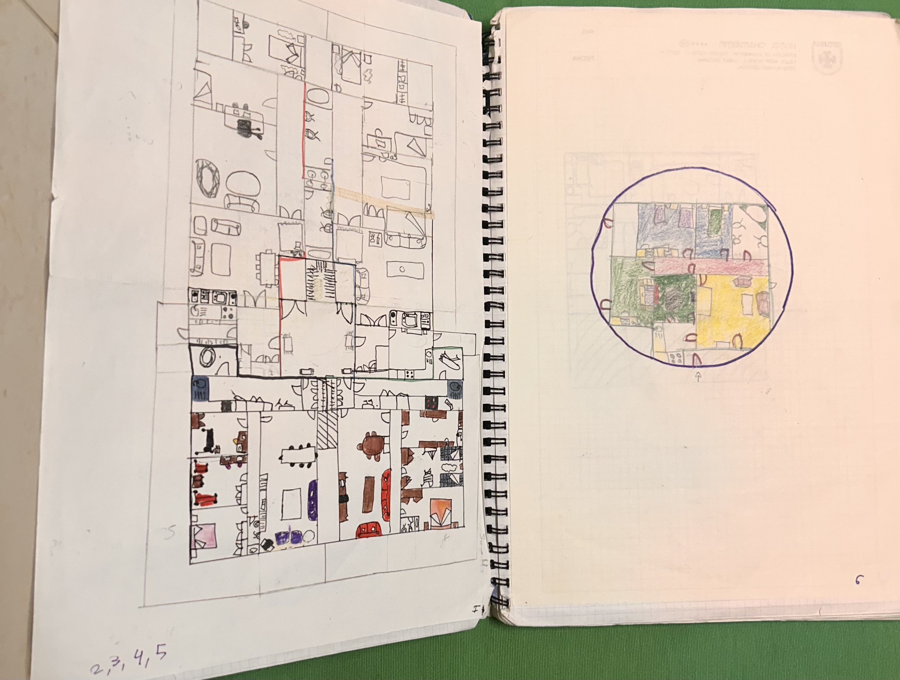
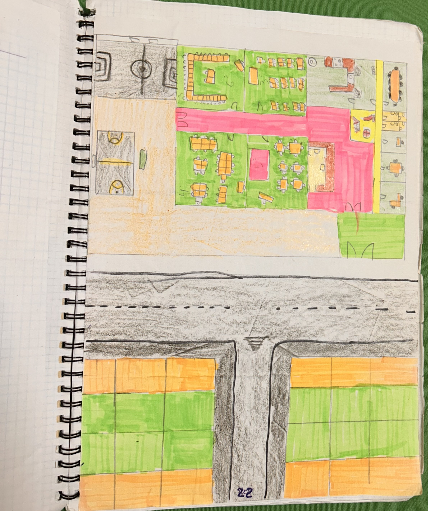
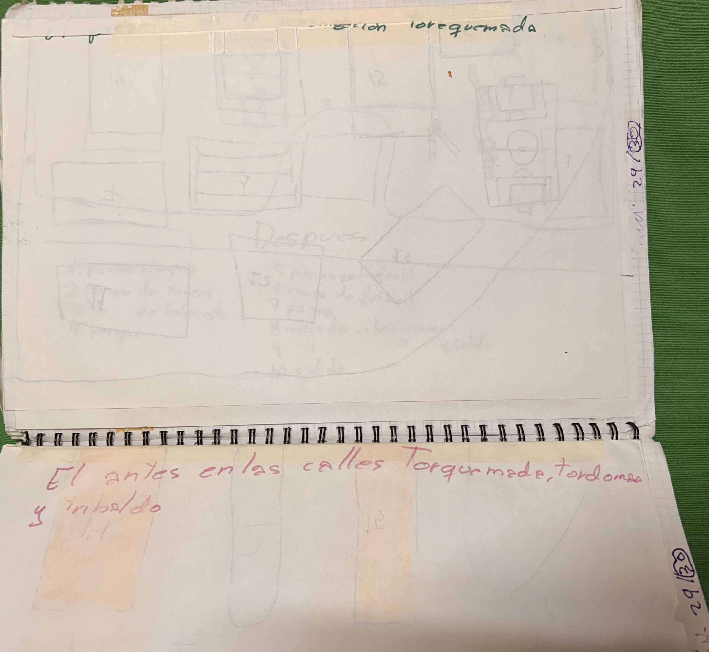
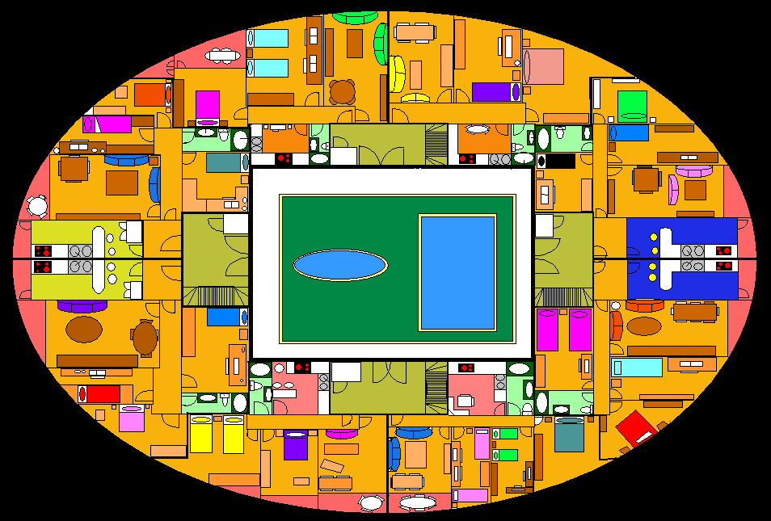

# 🏗️ Arqueología Operativa: De los planos a mano en libretas de espiral al MS Paint (2007)
*Cuando el diseño de arquitecturas, la optimización urbana y el urbanismo doméstico ya formaban parte del código fuente.*

Hacer arqueología digital y personal en los archivos de una misma es un ejercicio fascinante. Antes de las metodologías ágiles, de las herramientas de arquitectura en la nube y de la gestión avanzada de requisitos, ya existía una vocación innata por estructurar el espacio, optimizar recursos y maquetar el entorno con lo que había a mano. 

---

### 🗺️ El origen: Urbanismo doméstico y diseño en papel

Todo empezó mucho tiempo atrás. De pequeña, cuando en casa aparecían panfletos inmobiliarios con anuncios de viviendas, mis padres los iban recopilando. Yo los cogía y me imaginaba viviendo allí. Pero con el tiempo, los planos originales se volvían aburridos... necesitaban mi toque personal. 

Empecé a rediseñar mis propias casas, colegios y urbanizaciones enteras. Cuento con más de **70 planos trazados a mano** en libretas clásicas de espiral (con sus portadas de época, desde los Backstreet Boys hasta Leonardo DiCaprio custodiando los proyectos). 

En esos cuadernos se puede ver una auténtica **ingeniería de detalle**:
* Listados de control de **"Antes" y "Después"** con la reordenación de calles (*Torquemada, Tordomar, Tribaldo*).
* Distribución milimétrica de infraestructuras: piscinas olímpicas, campos de tenis, canchas de baloncesto, parques infantiles y zonas de acceso y salida optimizadas.
* Planos de plantas residenciales detallados habitación por habitación, con el mobiliario medido y colocado ergonómicamente.

---

### 💻 El salto al digital: Entre llamada y llamada, MS Paint (2007)

Con el paso del tiempo, los trazos a lápiz y boli evolucionaron al formato digital. Nos situamos en el año **2007**: época de conexiones ruidosas con routers de Wanadoo y la reina indiscutible del diseño amateur... **MS Paint**.

Entre llamada y llamada, los planos continuaban evolucionando en la pantalla. Cuando la tecnología disponible se limita a una paleta de colores plana y una cuadrícula de píxeles, la precisión no depende del software, sino del método:
* **Planos de distribución a escala casera:** Diseños y distribuciones de espacios donde cada mueble tenía su ubicación calculada milimétricamente.
* **Optimización de recursos y UX espacial:** Aprovechamiento máximo del espacio físico disponible aplicando criterios lógicos antes de que nadie nos hablase formalmente de *User Experience* o diseño de infraestructuras.

---

### 💡 Lecciones de una Analista Nativa

Mirar atrás y hojear esos más de 70 planos te hace sonreír, pero sobre todo revela una verdad innegable sobre el perfil técnico:
1. **La vocación analítica nace con una:** Mucho antes de gestionar sistemas complejos, redes o infraestructuras IT, ya estabas aplicando modelado de datos, diseño espacial y reingeniería de procesos en papel de cuadrícula.
2. **Las restricciones potencian el ingenio:** Trabajar con herramientas limitadas (un bolígrafo, una libreta o un archivo `.bmp` en Paint) obliga a estructurar la mente para resolver problemas complejos con recursos mínimos.
3. **El hilo conductor:** Desde una urbanización dibujada a mano en una libreta en los 90, pasando por los planos en Paint de 2007, hasta la automatización con IA y la gestión de procesos en 2026, la constante siempre ha sido la misma: **ordenar el caos y diseñar soluciones eficientes**.

---

## 📸 Galería Completa de Archivos Históricos & Planos

### 📖 Cuaderno de Espiral (Trazados a mano)

 

 

 

 

---

### 🎨 Diseños Digitales en MS Paint (2007)

 

---

* **Autor:** Cristina Huertas Román  
* **Categoría:** Arqueología Operativa / Evolución Técnica & Diseño  
* **Repositorio:** [chuertas26/myblog](https://chuertas26.github.io/myblog/)
